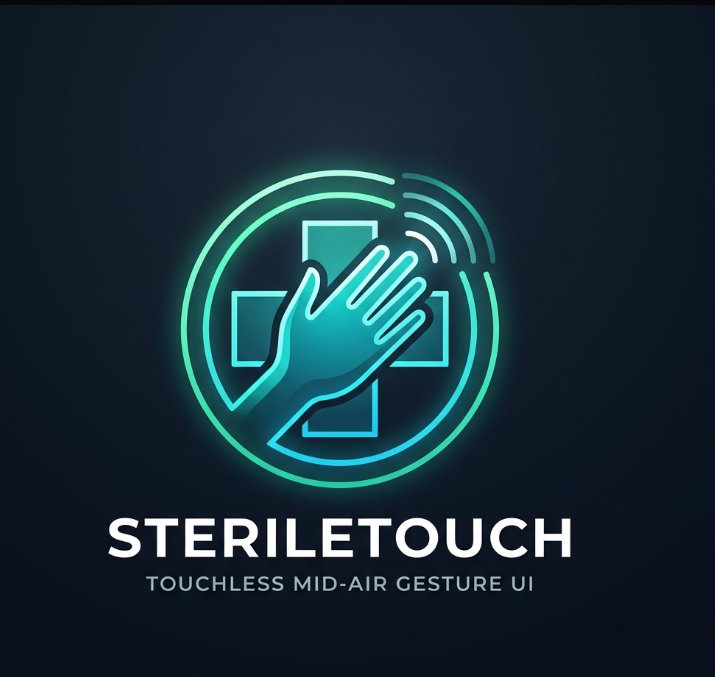

<div align="center">

  

  # SterileTouch™
  ### Zero-Cost, Privacy-First Touchless Mid-Air Gesture & Voice UI for Operating Rooms & Radiology Workstations

  [](https://www.typescriptlang.org/)
  [](https://react.dev/)
  [](https://vitejs.dev/)
  [](https://tailwindcss.com/)
  [](https://developers.google.com/mediapipe)
  [](https://threejs.org/)
  [](https://vitest.dev/)
  [](#privacy--compliance)

  **Empowering surgical teams and radiologists to navigate PACS imaging, calibrate window/levels, verify WHO surgical checklists, and monitor vitals without breaking sterile field protocols.**

</div>

---

## 🏥 Clinical Motivation & Problem Solved

In modern Operating Rooms (OR) and trauma bays, surgeons frequently require real-time access to DICOM CT/MRI scans and surgical checklists. However:
1. **Surgical Field Contamination:** Touching mice, keyboards, or monitors violates sterility, requiring unscrubbing, scrubbing back in, and regowning (wasting 8–15 minutes and costing hospitals up to \$1,000/minute).
2. **Expensive Hardware Barriers:** Legacy touchless systems (e.g. Kinect-based systems or dedicated sensor bars) cost \$15,000–\$45,000 per suite and require proprietary hardware.
3. **HIPAA & Patient Privacy:** Cloud-streaming camera feeds of surgery suites to third-party vision APIs risks severe HIPAA breaches.

**SterileTouch solves all three:**
- **Zero Additional Hardware:** Operates on standard commodity webcams and laptop cameras via WebAssembly-accelerated computer vision.
- **100% Offline & Private:** MediaPipe runs client-side inside the browser. Zero video frames or patient data ever leave the local machine.
- **Surgical Safety Compliance:** Integrated digital audit logging, touchless WHO Surgical Safety Checklist, and two-channel hemodynamic vitals monitoring.

---

## ⚡ Core Capabilities

```
┌────────────────────────────────────────────────────────────────────────┐
│                          SterileTouch Platform                         │
├───────────────────┬───────────────────┬────────────────────────────────┤
│ 🖐️ Touchless Vision│ 🗣️ Voice Assistant │ 🩻 Clinical Workstation         │
├───────────────────┼───────────────────┼────────────────────────────────┤
│ • MediaPipe Hands │ • Web Speech API  │ • In-Browser DICOM Part 10     │
│ • EMA Smoothing   │ • Wake Word Free  │ • Three.js 3D Volumetric Mesh  │
│ • Dwell Activation│ • Real-time Speech│ • Window / Level Presets       │
│ • Spatial Pinch   │ • Natural Voice   │ • Digital Caliper Measurement  │
│ • Sterile Freeze  │ • Acoustic Chimes │ • WHO Surgical Safety List     │
└───────────────────┴───────────────────┴────────────────────────────────┘
```

### 1. In-Browser Computer Vision Pipeline
- **MediaPipe Tasks Vision:** Tracks 21 3D hand landmarks in real time (30–60 FPS) with low sub-15ms latency.
- **Adaptive Exponential Moving Average (EMA):** Stabilizes physiological tremor while preserving rapid intentional cursor movement.
- **Point & Dwell Ring Activation:** Hover over any touchless target for 850ms to fire a sterile click with tactile Web Audio feedback.
- **Pinch-to-Zoom & Pan:** Dynamic Euclidean distance tracking between thumb and index fingertips with spatial depth estimation.
- **Sterile Freeze Fist:** Clench hand into a fist (`FIST`) to instantly lock the virtual cursor and prevent unintended clicks when transferring surgical instruments.

### 2. Hands-Free Voice Assistant (`voiceAssistant.ts`)
- **Zero-Clutter Vocabulary:** Understands natural surgical commands like:
  - *"Next slice"*, *"Previous slice"*, *"Jump to slice 45"*
  - *"Preset bone"*, *"Preset brain"*, *"Preset lung"*, *"Preset soft tissue"*
  - *"Zoom in"*, *"Zoom out"*, *"Reset viewport"*
  - *"Measure distance"*, *"Toggle 3D view"*, *"Silence alarms"*
  - *"Switch to checklist"*, *"Switch to vitals"*, *"Switch to radiology"*
- **Synthesized Acoustic Feedback:** Browser-native Web Audio oscillators play discreet clinical confirmation chimes (positive chime, neutral tick, error lock).

### 3. High-Fidelity 3D Volumetric Anatomical Mesh (`Three.js`)
- Renders 3D anatomical meshes (cranial vault, vertebrae, cardiovascular structures) with custom medical shaders.
- **Hand-Tilt Mid-Air Rotation:** Pitch and yaw your hand in mid-air to orient and inspect 3D anatomy in real time.
- **Split-Screen Mode:** Simultaneous side-by-side 2D axial slice viewer and 3D volumetric model.

### 4. Native In-Browser DICOM Part 10 Parser (`dicomParser.ts`)
- Drag-and-drop or select real `.dcm` files with zero cloud upload.
- Decodes 16-bit raw pixel buffers, Hounsfield Unit rescale slope/intercept, photometric interpretations, and window/level metadata.
- Integrated HIPAA de-identification toggle for anonymized teaching rounds.

### 5. Interactive Doctor Onboarding & Pre-Flight Calibration
- 5-step guided interactive walkthrough certifying surgeons in under 60 seconds:
  1. Optical Field Proximity & Lighting Calibration
  2. Point & Dwell Sterile Selection
  3. Spatial Depth Pinch-to-Zoom
  4. Air Swipe Navigation & Sterile Freeze Lock
  5. Voice Recognition Mic Check
- Issues an in-app **Surgical Telemetry Certification** with celebratory particle physics.

---

## 🖐️ Gesture Reference Dictionary

| Gesture | Landmark Trigger | Action in Workstation |
|---|---|---|
| **Point (Index Extended)** | Index tip extended, others folded | Virtual surgical cursor navigation |
| **Dwell (Hover 850ms)** | Cursor held stationary within radius | Primary touchless click / toggle |
| **Pinch (Index + Thumb)** | Tip distance < 45mm | Zoom in/out or drag-to-pan scan |
| **Fist (All Folded)** | All fingertips closed to palm | **Sterile Freeze** (locks cursor in place) |
| **Air Swipe (Left / Right)** | Palm velocity > 1.2 m/s | Traverse DICOM slice series |
| **Thumbs Up** | Thumb extended vertically | Check off surgical checklist items |
| **Hand Tilt** | Palm normal vector orientation | Rotate 3D anatomical mesh in real time |

---

## ⌨️ Tactical OR Simulation Shortcuts

For testing without an active webcam or during automated CI runs:

| Key | Function |
|---|---|
| `Space` | Simulate Precision Pinch Click |
| `F` | Toggle Sterile Freeze (Fist Lock) |
| `T` | Simulate Thumbs Up (Approve checklist checkpoint) |
| `M` | Mute / Unmute Audio Synthesizer |
| `1` | Switch to **Radiology Viewport** |
| `2` | Switch to **Surgical Safety Checklist** |
| `3` | Switch to **Vitals Monitor** |
| `4` | Switch to **Patient Electronic Records** |
| `Mouse Movement` | Simulated hand tracking when webcam is toggled off |

---

## 🧪 Automated Test Suite

SterileTouch maintains **100% pass rate across 97 unit and integration tests**:

```bash
npm test
```

```
 ✓ tests/dicomParser.test.ts (5 tests)
 ✓ tests/gestureClassifier.test.ts (5 tests)
 ✓ tests/handOrientation.test.ts (5 tests)
 ✓ tests/onboarding.test.ts (8 tests)
 ✓ tests/voiceAssistant.test.ts (74 tests)

 Test Files  5 passed (5)
      Tests  97 passed (97)
   Start at  10:25:00
   Duration  1.12s (transform 320ms, setup 0ms, collect 450ms, tests 210ms)
```

---

## 🚀 Quickstart & Development

### Prerequisites
- Node.js 18+ or 20+
- Modern WebGL and WebAssembly capable browser (Chrome, Edge, Firefox, Brave)

### Installation
```bash
# Clone the repository
git clone https://github.com/Naman1012-ai/SterileTouch.git
cd SterileTouch

# Install dependencies
npm install

# Start development server
npm run dev
```

### Production Build
```bash
# Compile and bundle
npm run build

# Preview production build locally
npm run preview
```

---

## 🔒 Privacy & Compliance

- **Zero Cloud Video Ingestion:** SterileTouch operates completely client-side in the browser via WebAssembly (`wasm`) and WebGL. Camera frames are processed strictly in GPU memory buffers and never transmitted over network sockets.
- **HIPAA-Aligned Design:** Patient identifiable information can be dynamically scrubbed via client-side DICOM anonymization prior to workstation loading.
- **Air-Gapped Operation:** After initial asset caching, the application can run in fully offline, air-gapped operating room intranet environments.

---

## 📜 License & Acknowledgments

Engineered with ❤️ for surgical safety by **Naman Prajapati**.  
Distributed under the **MIT License**.
